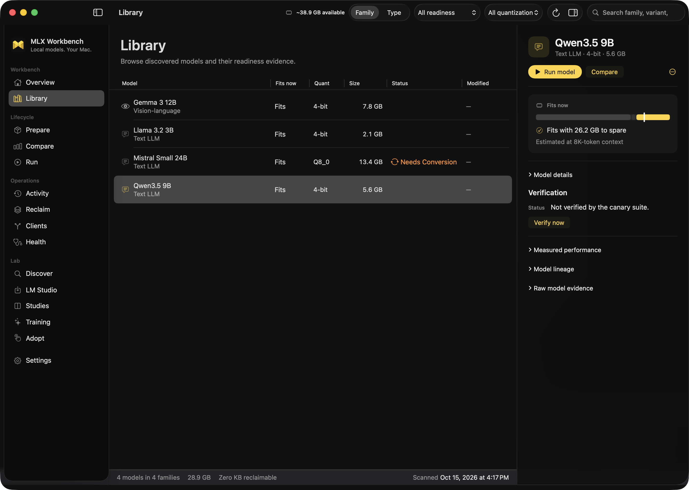
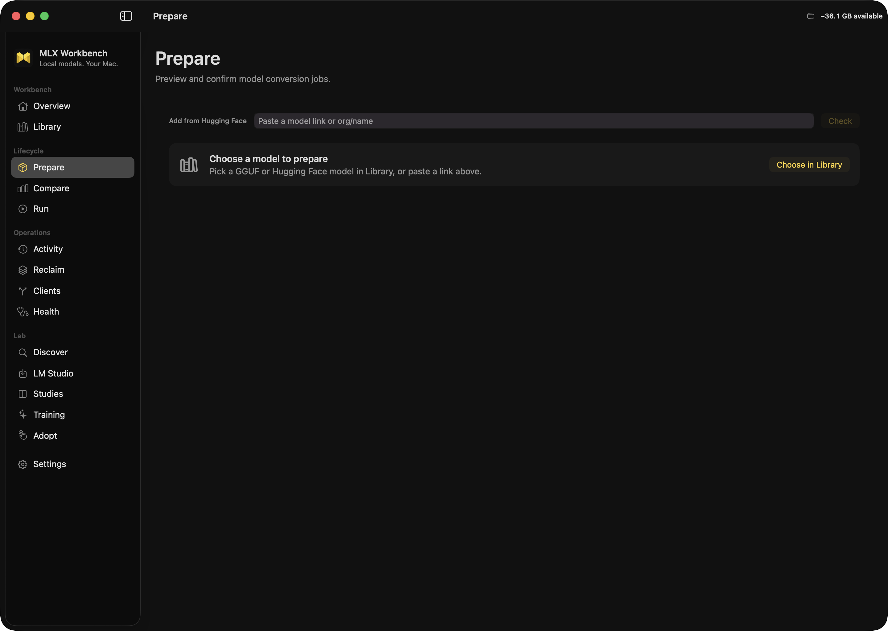
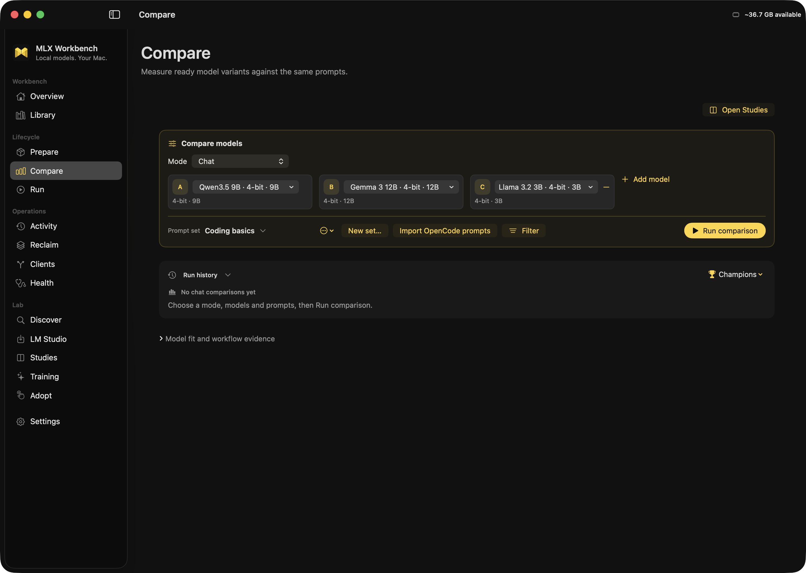

# mlx-workbench

A native macOS app for running local models on Apple Silicon. Find a model, convert it to MLX, verify it, serve it on a loopback port, compare it against alternatives and wire it into your coding tools.

MLX Workbench is the desktop front end for [mlx-agent](https://github.com/cavi-ai/mlx-agent). Every operation runs through the engine's `scripts/mlx-agent … --json` command line: each change is previewed before you confirm it, launched work leaves an engine receipt, and serving binds to `127.0.0.1`.



The native Library keeps model readiness and memory fit beside the selected model. Screenshots show illustrative inventory.

<details>
<summary>Prepare and compare models</summary>





</details>

## Install

Requires an Apple Silicon Mac, Git and Python 3.12 ([uv](https://github.com/astral-sh/uv) recommended).

Download `mlx-workbench-<version>.dmg` from the [latest release](https://github.com/cavi-ai/mlx-workbench/releases/latest) and drag **MLX Workbench** into **Applications**. The app runs the engine from a local checkout:

```bash
git clone --recurse-submodules https://github.com/cavi-ai/mlx-workbench.git
cd mlx-workbench
make install
```

Open the app and set **Settings → Engine → mlx-agent checkout** to the checkout's `vendor/mlx-agent`. The first-launch Setup Assistant walks through the same checks.

To build from source instead, run `make start` in the checkout after `make install`; it builds the app with Xcode and opens it.

## First model

1. **Library** lists the GGUF and MLX weights already on disk, with whether each fits in memory now.
2. Paste a Hugging Face link anywhere with ⇧⌘V. The intake window shows what the model is and how it converts before anything downloads.
3. **Prepare** previews the conversion, its output size and fit. **Confirm conversion** starts the job; supported task types then run a canary before the model is marked verified.
4. **Run** previews and starts a loopback server for the verified model.
5. **Clients** points opencode, Continue, Zed or Aider at that server, with backups and rollback.

See [Your first model](docs/mlx-workbench/source/pages/introduction/quickstart.md) for the full walkthrough.

## What it does

| Area | Screens | Highlights |
|---|---|---|
| Workbench | Overview, Library | Model budget, fit per model, model details and lineage |
| Lifecycle | Prepare, Compare, Run | Previewed conversion, quality gate canaries, measured comparisons in eight modes, always-on endpoints with load on request |
| Operations | Activity, Reclaim, Clients, Health | Job timeline, quarantine and Trash with restore, client config wiring with rollback, runtime readiness |
| Lab | Discover, LM Studio, Studies, Training, Adopt | Hub candidates with fit, LM Studio's downloads, text LoRA training with evaluation, controlled studies |

Qwen3.8-Flash-Next can also run on the optional [Strata runtime](docs/mlx-workbench/source/pages/workflows/strata.md) from a prepared GGUF pair.

## Documentation

Hosted at [cavi-ai.xyz/docs/mlx-workbench](https://cavi-ai.xyz/docs/mlx-workbench).

- Start: [Overview](docs/mlx-workbench/source/pages/introduction/overview.md), [Installation](docs/mlx-workbench/source/pages/introduction/installation.md), [Your first model](docs/mlx-workbench/source/pages/introduction/quickstart.md)
- Workflows: [Library](docs/mlx-workbench/source/pages/workflows/library.md), [Add from Hugging Face](docs/mlx-workbench/source/pages/workflows/hugging-face.md), [Prepare and verify](docs/mlx-workbench/source/pages/workflows/prepare.md), [Run and endpoints](docs/mlx-workbench/source/pages/workflows/run.md), [Compare](docs/mlx-workbench/source/pages/workflows/compare.md), [Clients](docs/mlx-workbench/source/pages/workflows/clients.md), [Reclaim](docs/mlx-workbench/source/pages/workflows/reclaim.md), [Discover and Adopt](docs/mlx-workbench/source/pages/workflows/discover.md), [Health and alerts](docs/mlx-workbench/source/pages/workflows/health.md), [Training and studies](docs/mlx-workbench/source/pages/workflows/training.md), [Strata](docs/mlx-workbench/source/pages/workflows/strata.md)
- Reference: [Configuration](docs/mlx-workbench/source/pages/reference/configuration.md), [State and files](docs/mlx-workbench/source/pages/reference/state.md), [Make targets](docs/mlx-workbench/source/pages/reference/make-targets.md)
- Operate: [Troubleshooting](docs/mlx-workbench/source/pages/guides/troubleshooting.md), [Security model](docs/mlx-workbench/source/pages/security/model.md), [Version and support](docs/mlx-workbench/source/pages/release/version-and-support.md)

## Contributing

```bash
make test        # Python compatibility and contract tests
make test-swift  # XCTest suite for the native app
make docs-test   # documentation contract tests
```

See [CONTRIBUTING.md](CONTRIBUTING.md) and [Development](docs/mlx-workbench/source/pages/guides/development.md). The docs are built from `docs/mlx-workbench/source` with `make docs-build` into the release asset `mlx-workbench-docs-v<version>.tar.gz`; the [consumer contract](docs/mlx-workbench/CONSUMER.md) describes it.

## License

MIT. See [LICENSE](LICENSE). mlx-agent is also MIT.
