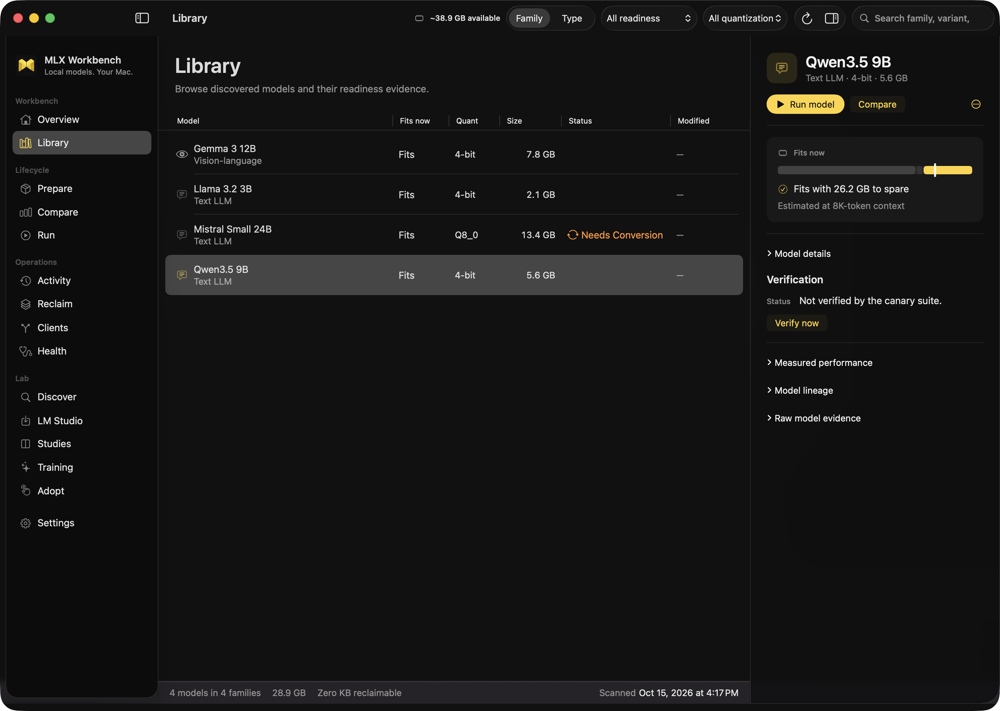
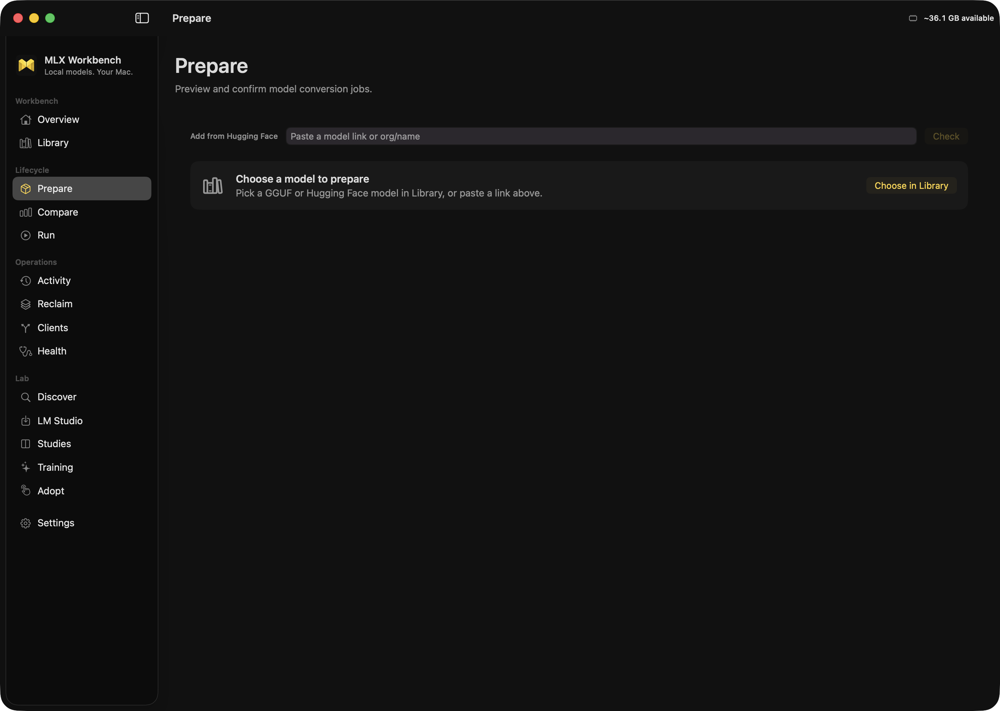
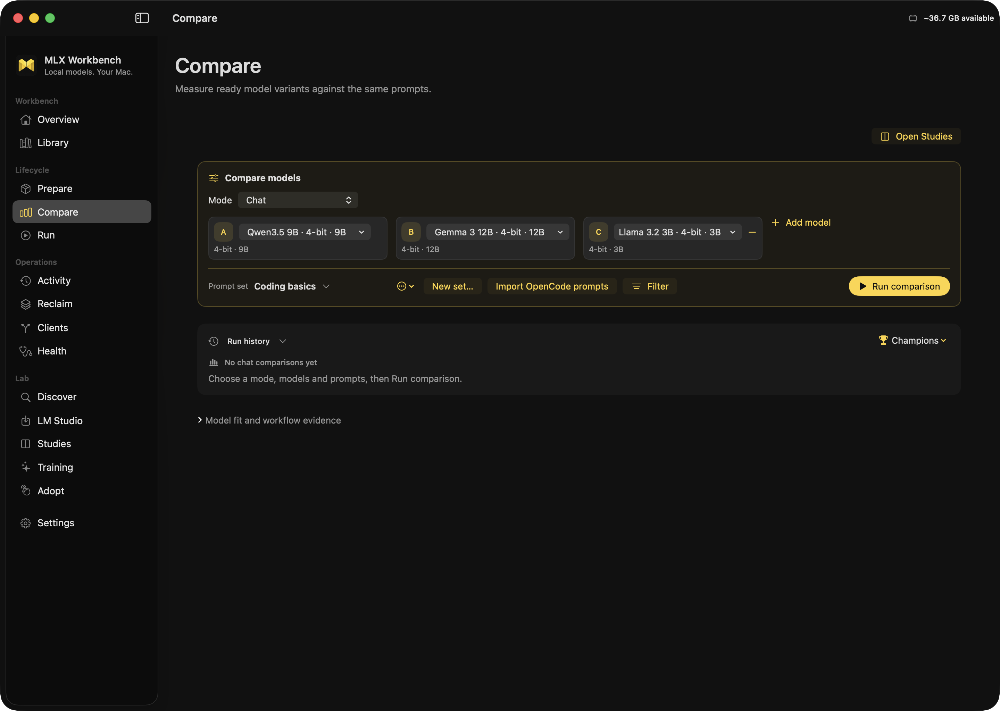

# mlx-workbench

**Find the models that work for you—on your Mac.**


[](https://github.com/cavi-ai/mlx-workbench/releases/latest)
[](LICENSE)

MLX Workbench is a native Apple Silicon app for preparing, comparing and running local AI. Give models the same task, inspect their actual outputs and compare measured performance on your machine. Choose what suits your work, with your model library, conversion and serving in the same app.

Compare text, images, audio, video and 3D results. Read responses side by side, switch between audio outputs on one timeline, inspect images with linked zoom or rotate a generated mesh. Then put your chosen models to work through local endpoints.

<details>
<summary>Inside Workbench</summary>



The native Library keeps model readiness and memory fit beside the selected model. Screenshots show illustrative inventory.





</details>

## Install

Requires an Apple Silicon Mac, Python 3.12 ([uv](https://github.com/astral-sh/uv) recommended) and Apple's Command Line Tools (`xcode-select --install`). Git is needed when using a source checkout.

Download `mlx-workbench-<version>.dmg` from the [latest release](https://github.com/cavi-ai/mlx-workbench/releases/latest) and drag **MLX Workbench** into **Applications**. In Setup Assistant, choose **Use bundled engine…**, confirm **Prepare engine**, then use **Install Runtime…** to install its Python dependencies. Preparing the engine copies the packaged sources; it does not install packages or download models.

You can also use a source checkout:

```bash
git clone --recurse-submodules https://github.com/cavi-ai/mlx-workbench.git
cd mlx-workbench
make install
```

Open the app and set **Settings → Engine → mlx-agent checkout** to the checkout's `vendor/mlx-agent`. The first-launch Setup Assistant walks through the same checks.

To build from source instead, run `make start` in the checkout after `make install`; it builds the app with Xcode and opens it.

## First model

1. The app opens on **Library**: one row per GGUF or MLX model on disk with its size, whether it fits in memory now and its state. The sidebar filters by kind of model or to **To convert**; **Model sources** shows local providers and registered cache folders.
2. Paste a Hugging Face link into the Library search field and press **Add**, or anywhere with ⇧⌘V. The intake window shows what the model is and how it converts before anything downloads.
3. **Prepare** previews the conversion, its output size and fit. **Confirm conversion** starts the job; supported task types then run a canary before the model is marked verified.
4. Select the model and choose **Chat** to try it, or **Serve** to preview and start a loopback server. **Monitor** shows live status, token usage and response throughput.
5. **Serving → Access** sets up OpenCode, OpenClaw, Hermes, Codex or Claude Code against that endpoint, tests the connection over Chat Completions, Responses or Messages, and keeps backups with **Undo setup**.

See [Your first model](docs/mlx-workbench/source/pages/introduction/quickstart.md) for the full walkthrough.

## Serve securely. Load just in time.

Keep model endpoints on your Mac with loopback binding. Enable **Require API key** to control client access; keys are stored in Keychain. Manage the address, authentication and inference settings together in the **Serving** inspector.

Saved endpoints support JIT loading through **Load on request**: the endpoint stays available while weights load for the first inference request. Concurrent cold requests share one load. Unload idle models to free memory, keep frequently used models resident, and let active streams finish before unloading.

Run up to eight endpoints side by side and put them behind one address: the **Workbench API** row in Serving routes chat, embeddings and classification requests by model name with one shared key. **Quick Connect** copies ready-to-run curl and Python calls for any running endpoint without exposing its key.

See [Serving and Monitor](docs/mlx-workbench/source/pages/workflows/run.md) for endpoint setup, API keys and residency controls.

## Tune memory and acceleration

- **Plan around your RAM.** Review model-fit estimates and live headroom. Configure idle unloading, a headroom reserve and a shared agent memory budget. Strata profiles add expert-memory and context controls.
- **Reuse work where it fits.** MLX-LM offers prompt-text reuse for source-copying edits; supported Qwen vision models can reuse image features. Compatible M5 configurations also offer experimental Q4 prompt-processing acceleration.
- **Choose the runtime for the job.** Compare one model across runtimes and settings with the same prompts, then inspect both the outputs and measured performance.

| Runtime | What it brings |
| --- | --- |
| MLX-LM | Native text decoding and batching, with optional prompt-text reuse |
| MLX-VLM | Vision-language inference, with repeated-image feature reuse on supported models |
| [Strata](docs/mlx-workbench/source/pages/workflows/strata.md) | Qwen3.8-Flash-Next text serving from supported GGUF packs, with speculative decoding, expert-memory budgets and context settings |
| [Splash](docs/mlx-workbench/source/pages/workflows/splash.md) | In-place serving of supported quantized MLX, GGUF and Strata profile weights with a matching DFlash2 draft, from **Start now** or Compare |

Strata and Splash are optional installations. Splash requires an M3 or newer Mac and macOS 26.4 or later. Use [Compare](docs/mlx-workbench/source/pages/workflows/compare.md) to judge the settings on your own workload.

## What it does

| Area | Screens | Highlights |
|---|---|---|
| Home | Overview, Use | Model budget, persistent conversations |
| Models | Library, Model sources, Discover, Convert, Disk space | One row per model with fit and state, filters by kind, an inspector led by Chat, Serve and Compare, lineage and evidence, provider inventories and cache folders, Hub candidates and task recommendations, previewed conversion from FP32 to 2-bit with quality gate canaries, disk by model with suggested removals and duplicate-file checks, quarantine and Trash with restore |
| Serving | Serving, Clients, Monitor | Always-on endpoints with load on request, API keys and memory policy, opt-in video and mesh reuse, guided client setup with connection tests and undo, live token, throughput and memory-owner monitoring |
| Studio | Compare, Experiments, Training, Terminal | Measured comparisons in ten modes, controlled studies, text LoRA training with evaluation, OpenCode or a shell in a chosen folder |
| System | Activity, Health, Settings | Job timeline, runtime readiness |

Served music models also generate sound effects and ambience.

Qwen3.8-Flash-Next can also run on the optional [Strata runtime](docs/mlx-workbench/source/pages/workflows/strata.md) from a prepared GGUF pair.

The optional [Splash runtime](docs/mlx-workbench/source/pages/workflows/splash.md) serves quantized MLX, GGUF and Strata profile weights in place with a DFlash2 draft, from **Start now** or a Compare lane, so one model compares across runtimes side by side.

## Documentation

Hosted at [cavi-ai.xyz/docs/mlx-workbench](https://cavi-ai.xyz/docs/mlx-workbench).

- Start: [Overview](docs/mlx-workbench/source/pages/introduction/overview.md), [Installation](docs/mlx-workbench/source/pages/introduction/installation.md), [Your first model](docs/mlx-workbench/source/pages/introduction/quickstart.md)
- Workflows: [Library](docs/mlx-workbench/source/pages/workflows/library.md), [Add from Hugging Face](docs/mlx-workbench/source/pages/workflows/hugging-face.md), [Prepare and verify](docs/mlx-workbench/source/pages/workflows/prepare.md), [Serving and Monitor](docs/mlx-workbench/source/pages/workflows/run.md), [Compare](docs/mlx-workbench/source/pages/workflows/compare.md), [Clients](docs/mlx-workbench/source/pages/workflows/clients.md), [Reclaim](docs/mlx-workbench/source/pages/workflows/reclaim.md), [Discover](docs/mlx-workbench/source/pages/workflows/discover.md), [Health and alerts](docs/mlx-workbench/source/pages/workflows/health.md), [Training and studies](docs/mlx-workbench/source/pages/workflows/training.md), [Strata](docs/mlx-workbench/source/pages/workflows/strata.md), [Splash](docs/mlx-workbench/source/pages/workflows/splash.md)
- Reference: [Configuration](docs/mlx-workbench/source/pages/reference/configuration.md), [State and files](docs/mlx-workbench/source/pages/reference/state.md), [Make targets](docs/mlx-workbench/source/pages/reference/make-targets.md)
- Operate: [Troubleshooting](docs/mlx-workbench/source/pages/guides/troubleshooting.md), [Security model](docs/mlx-workbench/source/pages/security/model.md), [Version and support](docs/mlx-workbench/source/pages/release/version-and-support.md)

## Contributing

```bash
make test        # Python compatibility and contract tests
make test-swift  # XCTest suite for the native app
make docs-test   # documentation contract tests
```

See [CONTRIBUTING.md](CONTRIBUTING.md) and [Development](docs/mlx-workbench/source/pages/guides/development.md). The docs are built from `docs/mlx-workbench/source` with `make docs-build` into the release asset `mlx-workbench-docs-v<version>.tar.gz`; the [consumer contract](docs/mlx-workbench/CONSUMER.md) describes it.

## License

MIT. See [LICENSE](LICENSE). mlx-agent is also MIT.
